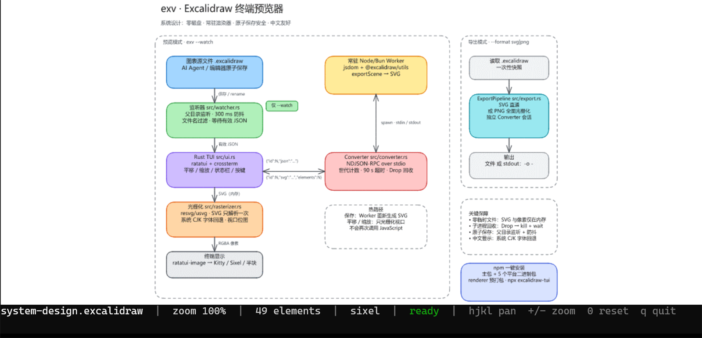
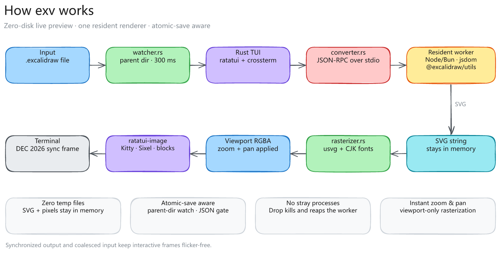
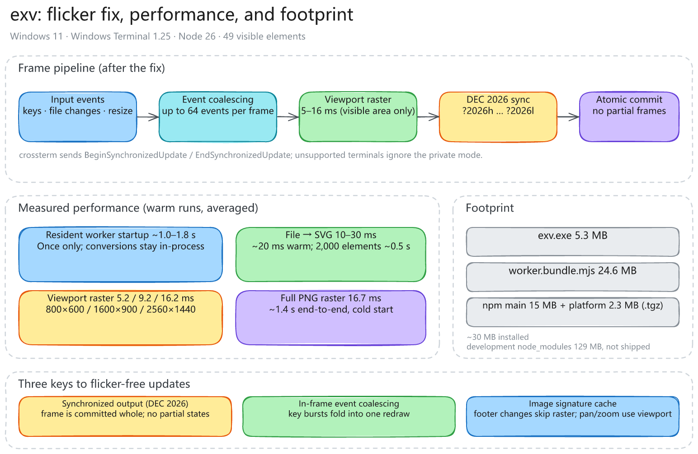

# excalidraw-tui (`exv`)

[English](README.md) | [简体中文](README.zh-CN.md)

Preview and convert Excalidraw diagrams from the terminal. Point `exv` at an
`.excalidraw` file to pan, zoom, and inspect it, or export SVG/PNG without
leaving the shell. Add `--watch` to refresh the terminal preview as an AI coding
agent writes.



`exv --watch` showing [`system-design.excalidraw`](system-design.excalidraw) in
Windows Terminal via Sixel. Full-size [PNG](docs/images/system-design.png) ·
[SVG](docs/images/system-design.svg).

```text
demo.excalidraw | 120% | 10 elements | kitty | ready | hjkl pan  +/- zoom  0 reset  q quit
```

## Why

- **No temporary files.** The SVG travels from the JavaScript renderer to Rust
  over a pipe; pixels go straight to the terminal. Only the output file you
  explicitly request with `--format` is written; there are no cache files.
- **Resident renderer.** One Node/Bun process loads the Excalidraw renderer once
  and converts documents over newline-delimited JSON-RPC, so reloads are fast.
- **Flicker-free updates.** Interactive frames are wrapped in DEC private mode
  2026 synchronized output when the terminal supports it, and bursts of key
  repeats are folded into one redraw. Unsupported terminals ignore the mode.
- **Atomic-save aware.** Editors and agents often write a temp file and rename
  it. With `--watch`, `exv` watches the parent directory, debounces 300 ms,
  validates JSON, and keeps the last good frame or export while a write is
  incomplete.
- **Chinese/CJK ready.** The renderer rewrites font stacks and the rasterizer
  uses system font fallback, so Chinese labels stay readable instead of tofu.
- **No stray processes.** The worker is killed and reaped on every exit path,
  including panic unwinds and terminal-pane `SIGHUP`.
- **Works across terminals.** Kitty graphics, Sixel, or Unicode half-blocks,
  auto-detected with a manual override.

## Requirements

- Node.js >= 22.22.2 (Node 24 LTS or 26 recommended)
- A terminal with Kitty graphics, Sixel, or any true-color terminal (half-blocks)

No Rust toolchain, C compiler, or renderer dependency install is needed for the
published packages: they contain a prebuilt `exv` binary and a bundled renderer.

| Terminal | Typical path |
| --- | --- |
| Kitty, Ghostty | Kitty graphics protocol |
| iTerm2, WezTerm, Rio | iTerm2 inline images |
| foot, mlterm, Sixel-enabled xterm | Sixel |
| Anything else | Unicode half-blocks fallback |

Use `--protocol` if auto-detection guesses wrong.

## Install

Install the `exv` command globally:

```sh
npm install -g excalidraw-tui
exv --watch diagram.excalidraw
```

The npm package selects a prebuilt binary for your platform through optional
dependencies:

| OS | Architectures | Binary notes |
| --- | --- | --- |
| Linux | x64, arm64 | statically linked with musl |
| macOS | Intel x64, Apple Silicon arm64 | native |
| Windows | x64 | native |

Keep optional dependencies enabled. Installing with `--omit=optional` removes
the platform binary and `exv` will explain how to reinstall. The bundled
renderer makes a complete install roughly 30 MB unpacked; see
[Performance and footprint](#performance-and-footprint).

Updating:

```sh
npm update -g excalidraw-tui
```

If no prebuilt binary exists for your OS or architecture, `exv` prints an
unsupported-platform error. For advanced setups, `EXV_BIN` can point the
launcher at a compatible binary, `EXV_RENDERER` at a custom `worker.mjs`, and
`EXV_JS_RUNTIME` at a specific Node or Bun executable.

## Usage

```text
exv [OPTIONS] <FILE>
```

```sh
exv diagram.excalidraw                              # static terminal preview
exv --watch diagram.excalidraw                      # live terminal preview
exv --theme dark --protocol kitty --watch architecture.excalidraw

exv diagram.excalidraw --format svg                 # -> diagram.svg
exv diagram.excalidraw --format png --scale 2       # -> diagram.png at 2x
exv diagram.excalidraw -o architecture.png          # format inferred from .png
exv diagram.excalidraw --format svg -o -            # SVG on stdout
```

| Flag | Description |
| --- | --- |
| `-w`, `--watch` | Keep the terminal preview open and refresh it on changes |
| `-f`, `--format <svg\|png>` | Convert instead of opening the terminal preview |
| `-o`, `--output <PATH>` | Export path; defaults to `<input>.svg` / `<input>.png`; `-` means stdout |
| `--scale <FACTOR>` | PNG resolution multiplier (default `1`, PNG only) |
| `--theme <light\|dark>` | Canvas theme for preview and PNG (default `light`) |
| `--protocol <auto\|kitty\|sixel\|halfblocks>` | Force a graphics protocol (preview only) |

Exports always run once and exit. `--watch` applies to the terminal preview
only. In preview watch mode the source may not exist yet: the parent directory
must exist, and `exv` waits until the first valid save. Atomic rename saves are
detected. Preview mode requires stdin and stdout to be a TTY; export mode works
in scripts and CI.

SVG export writes the renderer's vector output with font stacks normalized to
available system CJK fonts. PNG export rasterizes the complete diagram at its
intrinsic size times `--scale`, applies `--theme`, and enforces the same
40-million-pixel memory cap as the preview.

### Keys

| Key | Action |
| --- | --- |
| `h` `j` `k` `l` / arrow keys | Pan left/down/up/right |
| `+` or `=` | Zoom in 20% (re-rasterizes the SVG) |
| `-` or `_` | Zoom out 20% |
| `0` or `r` | Reset zoom and pan |
| `q`, `Esc`, `Ctrl+C` | Quit |

The status bar shows the filename, zoom percentage, element count, active
protocol, load/sync state, and the key legend.

## Live preview workflow

1. Start `exv --watch diagram.excalidraw` in a terminal pane next to your agent.
2. Ask the agent to create or update the file.
3. The watcher notices the atomic save, validates the JSON, and replaces the
   frame. Partial JSON shows `Syncing...` and keeps the previous image.
4. Fix the file if needed — the next valid save appears automatically.

`exv` is read-only with respect to your diagram; it never rewrites the file.

## AI agent integrations

Ready-to-copy rules live in `integrations/`:

- `integrations/CLAUDE.md` — Claude Code
- `integrations/AGENTS.md` — generic agent format
- `integrations/qoder-rules.md` — Qoder project rules

Merge the relevant file into your project instructions rather than replacing
existing ones. The rules cover the JSON skeleton, element/binding fields,
readable layout limits, validation, and how to preview with `exv`.

Example prompt:

> Create `architecture.excalidraw` showing the request path from CLI to database.
> Keep it under 10 nodes and validate the JSON. I will preview it with exv.

## How it works



A save is converted to SVG once, rasterized only for the visible viewport, and
committed to the terminal inside a synchronized frame. Pan and zoom reuse the
parsed SVG. [SVG](docs/images/architecture.svg) ·
[editable `.excalidraw` source](docs/diagrams/architecture.excalidraw).

| Path | Role |
| --- | --- |
| `src/main.rs` | CLI, preview/export modes, terminal session RAII, signal flags |
| `src/converter.rs` | Worker spawn/handshake/timeouts; `Drop` kills and waits |
| `src/export.rs` | One-shot SVG and PNG export pipeline |
| `src/rasterizer.rs` | SVG parse once, viewport/full-image rendering, light/dark themes |
| `src/ui.rs` | App state, keys, status bar, image sync |
| `src/watcher.rs` | Debounced parent-directory watch with filename filter |
| `renderer/worker.mjs` | jsdom environment, element normalization, `exportScene` |
| `npm/cli.js` | Selects the platform binary and launches it with inherited stdio |
| `scripts/prepare-npm.mjs` | Assembles and validates the npm tarballs |
| `tests/` | Chinese pipeline, export CLI, worker error recovery, atomic rename |

The renderer is bundled with esbuild into one file before publishing, so users
do not download `@excalidraw/utils`, jsdom, or their dependency tree. Preview
mode rasterizes only the visible viewport, and the SVG is parsed once per file
change, so zooming and panning do not invoke the JavaScript worker again.
Interactive frames use DEC 2026 synchronized output and coalesce queued input
events, so the terminal sees complete frames instead of intermediate cell
states. Export mode rasterizes the complete diagram once per save.

### Zero-disk and process-lifecycle guarantees

- No temporary SVG/PNG/cache files: SVG text and pixels stay in memory. An
  explicit `--format svg|png` export writes only the requested output path.
- One generation counter discards stale conversion results after rapid saves.
- `Converter::drop` closes stdin, kills the child, and waits for it. Unix
  builds also convert `SIGHUP`/`SIGINT`/`SIGQUIT`/`SIGTERM` into an orderly quit.
- Terminal raw mode and the alternate screen are restored by RAII, including on
  errors; synchronized updates are closed on exit as well.

## Performance and footprint

Measured on Windows 11 with Node 26 and a 49-element diagram using a release
build after warm-up. Treat these as ballpark figures: diagram complexity,
terminal protocol, and window size all move them.



The same numbers as the tables below, plus the frame pipeline after the flicker
fix. [SVG](docs/images/perf-overview.en.svg) ·
[editable `.excalidraw` source](docs/diagrams/perf-overview.en.excalidraw).

| Path | Measured |
| --- | --- |
| Renderer startup | ~1 s with the bundled renderer; 1.4–1.8 s from `node_modules` |
| File change → SVG (49 elements) | ~20 ms warm; ~0.5 s for 2,000 synthetic elements |
| Viewport rasterization (800×600 / 1600×900 / 2560×1440) | 5.2 / 9.2 / 16.2 ms |
| Full-diagram PNG raster (1444×1046) | 16.7 ms |
| End-to-end SVG/PNG export | ~1.4 s including worker startup |
| Idle working set | ~11 MB (`exv`) + ~8 MB (worker, trimmable) |
| Peak worker memory during a PNG export | ~171 MB (jsdom + Excalidraw) |

Zoom and pan never re-enter JavaScript: the SVG is parsed once per file change
and only the visible viewport is rasterized.

| Component | Size |
| --- | --- |
| `exv` binary | ~5.3 MB (stripped, thin LTO) |
| Bundled renderer | ~24.6 MB |
| npm install, main + platform package | ~30 MB unpacked |
| Development `renderer/node_modules` | ~129 MB, never shipped |

## Development

```sh
npm ci --prefix renderer
npm run bundle --prefix renderer
npm run smoke --prefix renderer
node --test tests/npm-cli.test.mjs
cargo test --locked                  # unit + watcher + pipeline + CLI export
cargo clippy --locked --all-targets -- -D warnings
cargo fmt --check
```

The pipeline and CLI export tests need Node or Bun plus `renderer/node_modules`;
otherwise they skip with a message. They convert the Chinese sample at
`tests/data/sample.excalidraw`, verify SVG and PNG output, check the per-request
error path, confirm the worker survives a malformed document, and rasterize the
SVG in memory.

`Cargo.lock` intentionally pins `notify-types` to `2.2.0`: version `2.3.x`
requires Rust 1.91. Build with `--locked`, or use a newer toolchain if you
update it.

To preview the npm artifacts locally:

```sh
cargo build --release --locked
node scripts/prepare-npm.mjs --local --pack
```

Tarballs land in `dist/npm/tarballs/`; the script validates their contents with
`npm pack --dry-run`. Release publishing is documented in
[RELEASING.md](RELEASING.md).

## Troubleshooting

| Symptom | Fix |
| --- | --- |
| Chinese labels are squares | Install a CJK system font such as Noto Sans CJK SC or Source Han Sans; the rasterizer falls back across installed fonts |
| `Node.js >=22.22.2 is required` | Upgrade Node; the renderer depends on a modern jsdom |
| Platform package is missing | Reinstall without `--omit=optional`; check `npm config get omit`, then run `npm install -g excalidraw-tui@latest` |
| `unsupported platform ...` | Use a supported platform or point `EXV_BIN` at a compatible binary |
| `must run in an interactive terminal` | Preview mode needs a TTY; use `--format svg\|png` to export from scripts or CI |
| `waiting for ...` forever | `--watch` needs the parent directory to exist; save valid JSON to the exact path |
| `Syncing...` stuck | The file currently has invalid/truncated JSON; run `jq . file.excalidraw` |
| Renderer fails to start | Check `node --version`; reinstall `excalidraw-tui`; or set `EXV_RENDERER` |
| Garbled or misplaced image | Try `--protocol halfblocks` first, then `sixel` / `kitty`; some terminals misreport font cell size |
| Blurry image in Zed | Zed's built-in terminal has no inline image protocol, so exv falls back to Unicode half-blocks; run exv in a Kitty/Sixel-capable terminal |
| Image does not update | Start the preview with `--watch`; the watcher filters by filename and watches the parent directory |
| `--watch only applies to the terminal preview` | Export commands run once; remove `--watch` when using `--format` |
| Export path is not written | The output directory must exist; `-o` cannot equal the input file; use `--format` when the extension is not `.svg`/`.png` |
| Build fails on `notify-types` MSRV | Use the committed `Cargo.lock` with Rust 1.88+, or update Rust |

## Limitations

- Custom Excalidraw fonts are not embedded; system fonts are used instead, with
  CJK fallback.
- Image elements render only when their base64 data is present in `files`.
- Very large documents are capped at 40 million raster pixels to protect memory.
- Prebuilt npm binaries cover Linux x64/arm64, macOS x64/arm64, and Windows x64;
  Windows arm64 is not covered.

## License

MIT
