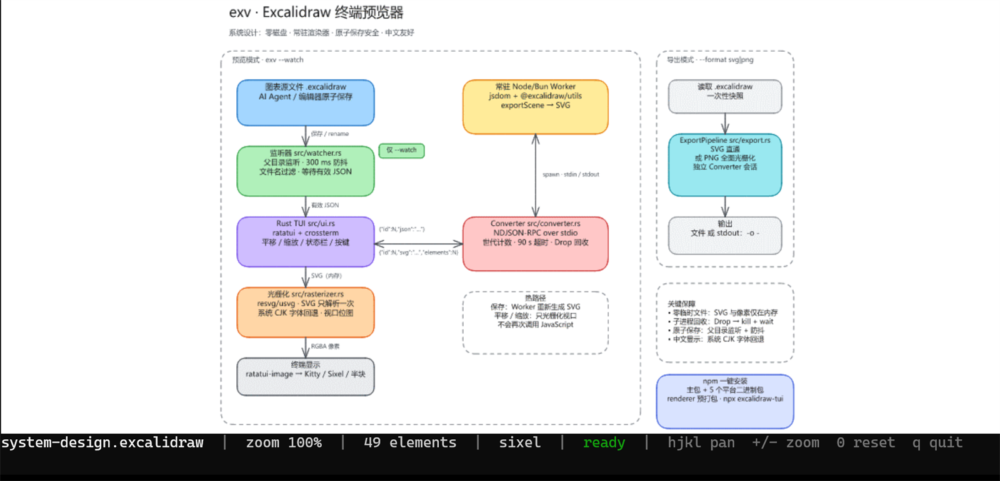
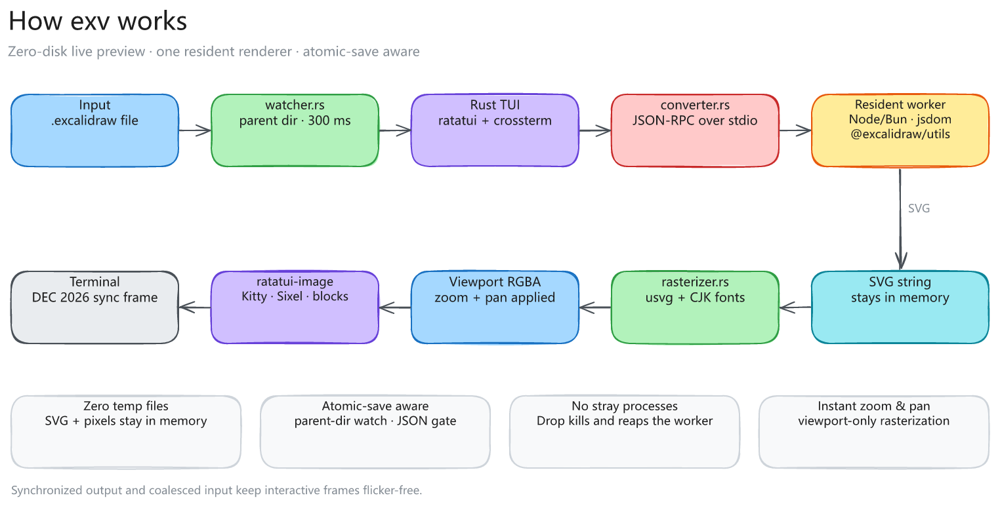
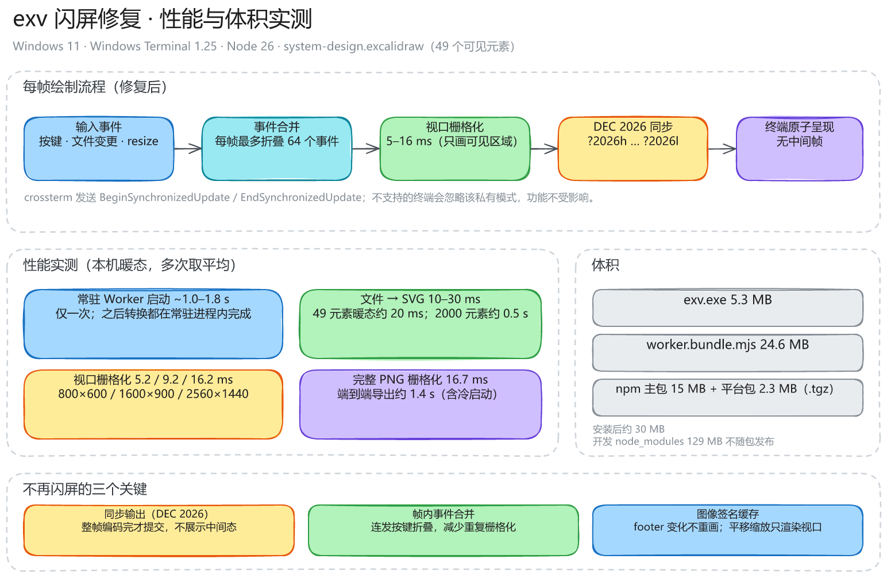

# excalidraw-tui (`exv`)

[English](README.md) | [简体中文](README.zh-CN.md)

在终端里预览和转换 Excalidraw 图表。把 `exv` 指向一个 `.excalidraw` 文件即可
平移、缩放、检查图表，也可以直接导出 SVG/PNG。加上 `--watch` 后，终端预览
画面会在 AI 编程助手写入时自动更新。



`exv --watch` 通过 Sixel 在 Windows Terminal 中显示
[`system-design.excalidraw`](system-design.excalidraw)。原尺寸
[PNG](docs/images/system-design.png) · [SVG](docs/images/system-design.svg)。

```text
demo.excalidraw | 120% | 10 elements | kitty | ready | hjkl pan  +/- zoom  0 reset  q quit
```

## 为什么选择 exv

- **不产生临时文件。** SVG 通过管道从 JavaScript 渲染器传到 Rust；像素直接
  送往终端。只有你显式使用 `--format` 指定的输出文件会被写入，没有缓存文件。
- **常驻渲染器。** 单个 Node/Bun 进程只加载一次 Excalidraw 渲染器，之后通过
  按行分隔的 JSON-RPC 转换文档，因此刷新很快。
- **刷新不闪屏。** 终端支持时，每帧使用 DEC 私有模式 2026 同步输出；连续按键
  会折叠成一次重绘。不支持该模式的终端会直接忽略。
- **兼容原子保存。** 编辑器和智能体通常先写临时文件再重命名覆盖。使用
  `--watch` 时，`exv` 监听父目录，做 300 毫秒防抖并校验 JSON；写入不完整时
  保留上一帧正常画面或导出结果。
- **中文/CJK 友好。** 渲染器会重写字体栈，光栅化器使用系统字体回退，中文标签
  不会变成方框乱码。
- **不残留子进程。** 无论正常退出、panic 展开，还是关闭终端窗格触发 `SIGHUP`，
  Worker 都会被强制终止并回收。
- **兼容多种终端。** 支持 Kitty 图形、Sixel 或 Unicode 半块，自动探测，也可手动
  指定。

## 环境要求

- Node.js >= 22.22.2（推荐 Node 24 LTS 或 26）
- 支持 Kitty 图形、Sixel，或任意真彩色终端（半块降级）

发布到 npm 的包已包含预编译的 `exv` 二进制和打包后的渲染器，因此用户不需要
Rust 工具链、C 编译器，也不需要安装渲染器依赖。

| 终端 | 常用路径 |
| --- | --- |
| Kitty、Ghostty、WezTerm | Kitty 图形协议 |
| iTerm2、foot、mlterm、WezTerm | Sixel |
| Zed 窗格 | 宿主终端协议透传（若支持） |
| 其他终端 | Unicode 半块降级 |

自动探测不准确时，使用 `--protocol` 指定协议。

## 安装

全局安装 `exv` 命令：

```sh
npm install -g excalidraw-tui
exv --watch diagram.excalidraw
```

npm 包通过 optional dependencies 为当前平台选择预编译二进制：

| 操作系统 | 架构 | 二进制说明 |
| --- | --- | --- |
| Linux | x64、arm64 | 使用 musl 静态链接 |
| macOS | Intel x64、Apple Silicon arm64 | 原生 |
| Windows | x64 | 原生 |

请保留 optional dependencies。使用 `--omit=optional` 会跳过平台二进制，
`exv` 会提示如何重新安装。打包后的渲染器会让完整安装约占 30 MB（解压后），
详见[性能与体积](#性能与体积)。

更新：

```sh
npm update -g excalidraw-tui
```

如果没有适用于你的系统或架构的预编译二进制，`exv` 会提示不支持该平台。高级
场景下，可用 `EXV_BIN` 指向兼容的二进制，`EXV_RENDERER` 指向自定义的
`worker.mjs`，`EXV_JS_RUNTIME` 指定 Node 或 Bun 可执行文件。

## 使用方式

```text
exv [OPTIONS] <FILE>
```

```sh
exv diagram.excalidraw                              # 一次性终端预览
exv --watch diagram.excalidraw                      # 实时终端预览
exv --theme dark --protocol kitty --watch architecture.excalidraw

exv diagram.excalidraw --format svg                 # 生成 diagram.svg
exv diagram.excalidraw --format png --scale 2       # 生成 2 倍分辨率 diagram.png
exv diagram.excalidraw -o architecture.png          # 从 .png 后缀推断格式
exv diagram.excalidraw --format svg -o -            # SVG 输出到 stdout
```

| 参数 | 说明 |
| --- | --- |
| `-w`, `--watch` | 保持终端预览打开，并在源文件变化时刷新 |
| `-f`, `--format <svg\|png>` | 转换并退出，不打开终端预览 |
| `-o`, `--output <PATH>` | 导出路径；默认 `<输入>.svg` / `<输入>.png`；`-` 表示 stdout |
| `--scale <FACTOR>` | PNG 分辨率倍数（默认 `1`，仅 PNG） |
| `--theme <light\|dark>` | 预览和 PNG 的画布主题（默认 `light`） |
| `--protocol <auto\|kitty\|sixel\|halfblocks>` | 强制指定图形协议（仅预览） |

导出始终只执行一次并退出，`--watch` 仅适用于终端预览。预览监听时源文件可以
尚不存在：父目录必须存在，`exv` 会等待第一次有效保存，并识别原子重命名。
终端预览要求 stdin 和 stdout 都是 TTY；导出模式可以在脚本和 CI 中使用。

SVG 导出写入渲染器生成的矢量内容，字体栈会归一化为系统可用的 CJK 字体。PNG
导出按“原始尺寸 × `--scale`”光栅化完整图表，应用 `--theme`，并沿用预览相同的
4000 万像素内存上限。

### 按键

| 按键 | 操作 |
| --- | --- |
| `h` `j` `k` `l` / 方向键 | 向左/下/上/右平移 |
| `+` 或 `=` | 放大 20%（重新光栅化 SVG） |
| `-` 或 `_` | 缩小 20% |
| `0` 或 `r` | 重置缩放与平移 |
| `q`、`Esc`、`Ctrl+C` | 退出 |

状态栏显示文件名、缩放百分比、元素数量、当前协议、加载/同步状态和按键提示。

## 实时预览工作流

1. 在 AI 编程助手旁边的终端窗格中执行 `exv --watch diagram.excalidraw`。
2. 让智能体创建或更新该文件。
3. 监听器发现原子保存、校验 JSON，然后替换画面。写入不完整时显示
   `Syncing...`，并保留上一张正常图像。
4. 如需修正，直接改文件；下一次有效保存会自动显示。

`exv` 对图表文件只读，绝不会改写你的 `.excalidraw`。

## AI 智能体集成

可直接复制到项目中的规则位于 `integrations/`：

- `integrations/CLAUDE.md` —— Claude Code
- `integrations/AGENTS.md` —— 通用智能体格式
- `integrations/qoder-rules.md` —— Qoder 项目规则

请将这些内容合并进项目说明，而不是粗暴替换现有规则。规则涵盖 JSON 骨架、
元素与绑定字段、可读性布局限制、校验方式以及如何用 `exv` 预览。

示例提示词：

> 创建 `architecture.excalidraw`，展示从 CLI 到数据库的请求路径。节点不超过
> 10 个，并校验 JSON。我会用 exv 预览。

## 实现原理



每次保存只转换一次 SVG，并且只光栅化可见视口，然后在同步帧中一次性提交给
终端；缩放和平移复用已解析的 SVG。[SVG](docs/images/architecture.svg) ·
[可编辑的 `.excalidraw` 源文件](docs/diagrams/architecture.excalidraw)。

| 路径 | 职责 |
| --- | --- |
| `src/main.rs` | CLI、预览/导出模式、终端会话 RAII、信号处理 |
| `src/converter.rs` | Worker 启动/握手/超时；`Drop` 中 kill 并 wait |
| `src/export.rs` | 一次性 SVG 与 PNG 导出流程 |
| `src/rasterizer.rs` | SVG 解析一次、视口/完整图像渲染、明暗主题 |
| `src/ui.rs` | 应用状态、按键、状态栏、图像同步 |
| `src/watcher.rs` | 带防抖的父目录监听与文件名过滤 |
| `renderer/worker.mjs` | jsdom 环境、元素归一化、`exportScene` |
| `npm/cli.js` | 选择平台二进制，并以继承的标准流启动 |
| `scripts/prepare-npm.mjs` | 组装并校验 npm tarball |
| `tests/` | 中文全链路、导出 CLI、Worker 错误恢复、原子重命名 |

发布前会用 esbuild 把渲染器打包成单个文件，用户无需下载 `@excalidraw/utils`、
jsdom 及其依赖树。预览模式只光栅化当前可见视口，且每次文件变化只解析一次
SVG，因此缩放和平移不会再次调用 JavaScript Worker。交互帧使用 DEC 2026 同步
输出，并合并排队的输入事件，终端只会看到完整帧，而不是中间状态。导出模式
每次保存完整光栅化一次图表。

### 零临时文件与进程生命周期保证

- 不写任何临时 SVG/PNG/缓存文件：SVG 文本和像素都留在内存中。只有显式
  `--format svg|png` 指定的输出路径会被写入。
- 用世代计数器丢弃快速连续保存产生的过期转换结果。
- `Converter::drop` 会关闭 stdin、终止子进程并等待回收。Unix 构建还会把
  `SIGHUP`/`SIGINT`/`SIGQUIT`/`SIGTERM` 转换为有序退出。
- 终端原始模式和备用屏幕通过 RAII 恢复，错误路径也不例外；退出时也会关闭
  同步更新模式。

## 性能与体积

以下数据在 Windows 11、Node 26、49 元素图表上实测，使用 release 构建并预热。
它们只是量级参考：图表复杂度、终端协议和窗口大小都会影响结果。



图中数字与下方表格一致，另含修复闪屏后的帧流水线。
[SVG](docs/images/perf-overview.svg) ·
[可编辑的 `.excalidraw` 源文件](docs/diagrams/perf-overview.excalidraw)。

| 路径 | 实测 |
| --- | --- |
| 渲染器启动 | 发布包约 1 s；从 `node_modules` 启动 1.4–1.8 s |
| 文件变更 → SVG（49 元素） | 暖态约 20 ms；2000 个合成元素约 0.5 s |
| 视口光栅化（800×600 / 1600×900 / 2560×1440） | 5.2 / 9.2 / 16.2 ms |
| 完整图 PNG 光栅化（1444×1046） | 16.7 ms |
| SVG/PNG 端到端导出 | 约 1.4 s（含 Worker 启动） |
| 空闲驻留内存 | `exv` 约 11 MB + Worker 约 8 MB（可被系统回收） |
| PNG 导出转换时的 Worker 峰值内存 | 约 171 MB（jsdom + Excalidraw） |

缩放和平移不会再次调用 JavaScript：每次文件变化只解析一次 SVG，并且只光栅化
可见视口。

| 组成 | 大小 |
| --- | --- |
| `exv` 二进制 | 约 5.3 MB（strip + thin LTO） |
| 打包后的渲染器 | 约 24.6 MB |
| npm 安装（主包 + 平台包） | 解压后约 30 MB |
| 开发用 `renderer/node_modules` | 约 129 MB，不随包发布 |

## 开发

```sh
npm ci --prefix renderer
npm run bundle --prefix renderer
npm run smoke --prefix renderer
node --test tests/npm-cli.test.mjs
cargo test --locked                  # 单元测试 + watcher + 全链路 + CLI 导出
cargo clippy --locked --all-targets -- -D warnings
cargo fmt --check
```

全链路和 CLI 导出测试需要 Node 或 Bun，以及 `renderer/node_modules`；否则会
打印原因并跳过。测试会转换 `tests/data/sample.excalidraw` 中的中文样例，验证
SVG 和 PNG 输出，检查单次请求错误路径，确认 Worker 在收到畸形文档后仍能继续
工作，并在内存中完成 SVG 光栅化。

`Cargo.lock` 有意将 `notify-types` 固定在 `2.2.0`：`2.3.x` 要求 Rust 1.91。
请使用 `--locked` 构建；如需升级，请换用更新的工具链。

本地预览 npm 产物：

```sh
cargo build --release --locked
node scripts/prepare-npm.mjs --local --pack
```

tarball 位于 `dist/npm/tarballs/`；脚本会用 `npm pack --dry-run` 校验内容。
正式发布流程见 [RELEASING.md](RELEASING.md)。

## 故障排查

| 现象 | 处理方式 |
| --- | --- |
| 中文显示为方框 | 安装 CJK 系统字体，例如 Noto Sans CJK SC 或思源黑体；光栅化器会在已安装字体间回退 |
| 提示 `Node.js >=22.22.2 is required` | 升级 Node；渲染器依赖较新的 jsdom |
| 平台包缺失 | 不要使用 `--omit=optional` 重新安装；检查 `npm config get omit`，然后运行 `npm install -g excalidraw-tui@latest` |
| `unsupported platform ...` | 使用受支持的平台，或用 `EXV_BIN` 指向兼容的二进制 |
| 提示 `must run in an interactive terminal` | 预览模式需要 TTY；在脚本或 CI 中请用 `--format svg\|png` 导出 |
| 一直显示 `waiting for ...` | `--watch` 要求父目录存在；并把有效 JSON 保存到确切路径 |
| 一直停在 `Syncing...` | 当前文件 JSON 无效或被截断；运行 `jq . file.excalidraw` 检查 |
| 渲染器无法启动 | 检查 `node --version`；重新安装 `excalidraw-tui`；或设置 `EXV_RENDERER` |
| 图像错位或乱码 | 先试 `--protocol halfblocks`，再试 `sixel` / `kitty`；部分终端会错误报告字符单元格尺寸 |
| 图像不刷新 | 启动预览时加上 `--watch`；监听器按文件名过滤并监听父目录 |
| 提示 `--watch only applies to the terminal preview` | 导出只执行一次；使用 `--format` 时去掉 `--watch` |
| 导出文件没有生成 | 输出目录必须存在；`-o` 不能与输入文件相同；后缀不是 `.svg`/`.png` 时需加 `--format` |
| 构建因 `notify-types` 的 MSRV 失败 | 使用仓库中的 `Cargo.lock` 配合 Rust 1.88+，或升级 Rust |

## 限制

- 不内嵌 Excalidraw 自定义字体，改用系统字体并带 CJK 回退。
- 图片元素只有在 `files` 中包含 base64 数据时才能渲染。
- 超大型文档的光栅像素上限为 4000 万，以保护内存。
- 预编译 npm 二进制覆盖 Linux x64/arm64、macOS x64/arm64 和 Windows x64；
  暂不覆盖 Windows arm64。

## 许可证

MIT
